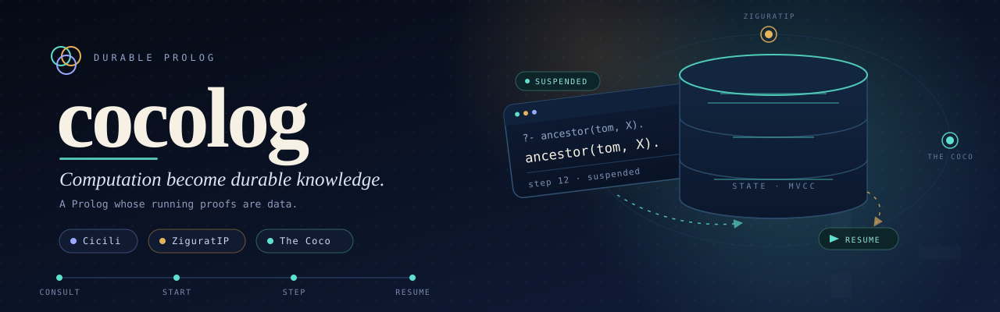

# cocolog

<p align="center">
  
</p>

**Computation become durable knowledge.**

cocolog is a Prolog -- the ISO core, the everyday conveniences, and a checked
table for the few places it deliberately differs -- and a **state machine**,
whose running proofs are data that can be suspended into a database and
finished by another process, on another machine, a day later.

It is written in [Cicili](https://github.com/saman-pasha/cicili) and keeps its
knowledge base in [ZiguratIP](https://github.com/saman-pasha/ziguratip), and it
uses both without modifying either. One binary carries the interpreter, the
embedded MVCC store, the module loader and a Go-like scheduler; the knowledge
base is a runtime arrangement, not a build.

```console
$ cocolog --kb demo consult demo/family.pl
consulted 12 clause(s) into 'demo'

$ cocolog --kb demo start job "ancestor(tom,X)"
started 'job'

$ cocolog --kb demo --steps 12 step job          # one process
  1. ancestor(tom,bob)
  2. ancestor(tom,liz)
  3. ancestor(tom,ann)
  4. ancestor(tom,pat)
job: suspended at 12 inference(s), 4 answer(s) this turn

$ cocolog --kb demo --steps 12 step job          # a different process
  1. ancestor(tom,jim)
  2. ancestor(tom,zoe)
job: suspended at 24 inference(s), 2 answer(s) this turn
```

Between those two commands the machine was not in memory anywhere. It was
fifteen kilobytes of ASCII in a table, in four chunks: about a hundred bytes of
proof, and the names of every atom and functor it might meet.

**And its flow libraries are among the most powerful debugging tools a Prolog
has** -- a program charted without running it, and a run explained at no cost to
it. See [The flow libraries](#the-flow-libraries) below.

## What it is

| | |
|---|---|
| **A language** | A Prolog: the ISO core, DCGs, exceptions, `format`, eight libraries copied unmodified from SWI and read at start-up. The places it deliberately differs from the reference implementations are one table, every row checked by running the same goal on both: [COMPAT.md](COMPAT.md). |
| **A state machine** | A proof is a term. Freeze it, store it, read it back in another process, go on. The store is MVCC (ZiguratIP's MVCCS), transactional by the turn, and a clause is a row. |
| **A concurrency model** | Green threads as in Go -- `go`, `yield`, `await`, channels -- over ONE shared store, one worker a core, preempted at 10,000 steps. Real threads, which share nothing and copy terms. |
| **A bridge** | Twenty loadable modules over C and C++ libraries, each declared in a Cicili binding and called as Prolog: sockets, TLS, HTTP, WebSocket, OpenCV, raylib, libtorch, TensorFlow, curl, cryptography. No C pasted into Prolog strings. |

One binary. The knowledge base is chosen at run time: in memory (`--local`,
the default), in a ZiguratIP server over its binary protocol (`--kb`), over
TLS (`--tls`), over Zeytun/HTTP (`--http`, `--https`), or in the embedded store
linked into the binary itself (`--embed`). An embedded store is one process's at
a time: a second process over it waits its turn (`COCOLOG_STORE_WAIT=S` bounds
the wait), and a store damaged some other way says so when it is opened or read.

## The one decision everything follows from

A term is an **index into a flat array of 64-bit cells**, not a pointer into a
graph, and the engine **never recurses in C**: the continuation is a term on the
heap and the choice points are an array of integers.

Written the natural way -- malloc'd term nodes and a recursive `solve()` that
uses the C stack as its continuation -- an interpreter is half the length. But
its state is then pointers and stack frames, and neither is data. cocolog exists
to stop mid-proof and go into a database, so:

| | |
|---|---|
| terms are indices | an array of indices is position independent: write it out, read it back at a different address, and every reference still means what it meant |
| the continuation is a term | `'$k'(Goal, Barrier, Rest)` on the heap, so a pending goal is a cell like any other |
| a cut barrier travels per goal | a suspended machine remembers the barrier of every pending goal, not only the current one |
| choice points are integer frames | `{kind, goals, trail_mark, heap_mark, call, pred, clause_ix, barrier}` and nothing else |

Freezing a machine is printing six arrays; thawing one is reading them back.
Every later choice -- compiled clauses, guards, environments, the heap
collector, the tracer, the green scheduler -- either preserves that property or
states in the code why it does not.

## Philosophy

* **The letter of the language, where it matters.** Not "familiar": the same
  text, the same errors, the same exit statuses. A float is written as the
  shortest text that reads back as the same double; `catch/3` stops catching
  once its goal exits; a cyclic term prints `@(S_1,[S_1=f(S_1)])`.
  `test/files/*.pl` runs the same files under a reference Prolog and compares
  every answer, and [COMPAT.md](COMPAT.md) is the one table of the places
  cocolog does not agree.
* **Measure, then claim.** No sentence in the benchmark claims a number that has
  not been printed by a run, and every lane's answers are checked against every
  other lane's before a time may print. The comparison pages keep cocolog's
  losses in: syntax errors, tabling, strings, ecosystem. See
  [bench/README.md](bench/README.md).
* **Documentation that runs.** Every tutorial is a program whose claims are
  `must/3` checks; the suite runs all 133 lessons. A lesson that stops being
  true fails and names both answers. The whole tree lints clean, held there by
  `cocolint` and `test/lint.pl`.
* **One mechanism, not two.** Errors are catchable and carry the raised ball; a
  module is a C API bound in Cicili; a library is clauses; a server page is a
  clause; a grammar is compiled in the engine. There is no second language
  hiding under the first.
* **Nothing rewritten that can be imported.** Eight of SWI's libraries, copied
  unmodified (BSD-2) into `lib/swipl/`; OpenSSL for crypto and TLS; libcurl for
  curl; ZiguratIP for the durable store; cicili for the language. The repository
  owns what it must -- the engine, the state format, the seam -- and borrows the
  rest.
* **The store is a seam, not a dependency.** The same feature is considered in
  every arrangement -- local, embedded, server, Zeytun -- and the differences
  are documented where they matter (a turn is a transaction; an httpd worker
  answers an isolated proof over a fresh store).

## Assets

**The engine** (`lib/`) -- cells and the trail; a reader and a writer that
agree with the standard text; compiled clauses (head and body programs keyed by the clause's cell);
guards that run a body's leading arithmetic as its clause is entered;
environments for bodies with constructs; a sliding mark-compact heap collector;
a tracer and recorder that record exactly what they print; limits in inferences
and steps; a backtrace carried by the throw itself.

**The state format** (`lib/state.cicili`) -- a suspended machine as text; four
sections plus the names; thawed, resumed and finished by any process.

**The knowledge base** (`lib/kb.cicili`, `lib/zigurat-kb.cicili`,
`lib/zeytun-kb.cicili`, `embed/`, `parsi/`) -- a clause store with five backend
hooks, an in-memory arrangement, an embedded MVCC store, a binary wire to a
ZiguratIP server and an HTTP arrangement; turns as transactions; vacuum and
compaction; pages and procedures compiled into the server (`parsi/`).

**The scheduler** (`lib/green.cicili`, `library/async.pl`) -- green threads in
a world of one worker a core (`async_workers/1` answers it), one store,
shared name tables, a write barrier that stops the world, channels, futures,
deadlock detection. Tier 1: there with no import.

**The libraries** -- tier 1 always present: `apply builtins dcg files library
lists zigurat`; **eight of SWI's own libraries, copied unmodified under their
BSD-2 headers into `lib/swipl/` and read at start-up**, so they need no import:
`assoc`, `pairs`, `ordsets`, `yall`, `aggregate`, `ugraphs`, `dcg_basics` and
`dcg_high_order`; `async`; and since 2.16.0 `print_message`, swipl's
`print_message/2` with `message_to_string/2`, `print_message_lines/3`,
`message_hook/3` and `prolog:message//1`, the kinds, prefixes and error text
held to swipl 9.0.4. Tier 2 is loaded on demand from
`$COCOLOG_LIBRARY`:
`http`, `httpd`, `websocket`, `json`, `xml`, `html`, `ca`, `kbs`, `cowork`,
`main`, `astar`, `hex`, `template`, `clay_ray`, `tensor_expr`, `llm`, plus the
two families below -- `library/flow/` and `library/reasoning/`.

**The modules** (twenty; `sh modules/NAME/build.sh`, not part of `make`):

| needs nothing | `tcp` `thread` `process` `text` `os` `signal` `clay` `stream` |
|---|---|
| a built ZiguratIP | `sha` `aes` `der` `x509` `tls` `bigint` |
| an external library | `curl`, `torch`, `tensorflow`, `ray`, `numpy`, `opencv` |

**The tools** -- `cocolint` (the dialect linter; the whole tree is clean);
`library(flow/chart)` and `library(flow/debug)` (below); `tools/compile/`
(which clauses nothing changes while a program runs); `tools/cc/` (the clang
wrappers every build uses); `bench/langs.sh` and `bench/concurrency.sh` (the
benchmarks against CPython, Go, Rust, asyncio and the reference Prolog),
and `bench/tokens.pl` (what a model spends writing the same programs in
cocolog and in Python);
`tutorials/` (133 lessons that run); `test/` (the suite).

## Solutions to real problems

**A computation that outlives its process.** Start a query against the
knowledge base, take a turn of it, halt. The next process -- tomorrow, on
another host -- steps it again, or runs it to the end. No checkpointing layer,
no serialized C stack: the proof is clauses in a table, and the turn's writes
committed as one transaction. `library(kbs)` is the same idea with a handful of
named jobs held by the store.

**Knowledge that must be durable and fast.** A clause is a row; a keyed lookup
is an index probe. On the language benchmark's store lane, a thousand keyed
lookups over two hundred facts cost `--embed` 0.36 ms against `python +
sqlite3`'s 11.9 ms -- **33x faster** (36x through the server), and a
hundred-thousand-addend counting loop, where every addend is a row, is 2.1x
faster. Level on naive reverse; 1.3-2.4x behind where the work is computation
over data read once. The table and the method are in
[bench/README.md](bench/README.md), and Run N is the run above.

**Text and language at corpus scale.** `library(reasoning)` reads controlled
English into an IR and writes it into a lesson's language; its translator
crosses Italian, Spanish and English newspaper prose, the tagger is a GRU over
`tensor_expr`, and the corpus, lexicon and model are all in the repository. New
articles are taken through a fixed loop -- shapes, `extra/` lines, a fresh
store, controls against every earlier article, a data column against the old
store -- and every inference count is recorded. Lessons 43-46.

**Concurrency with one truth.** Green threads share one store: an `assertz` in
one task is seen by the next, because it is their store, and writes take the
world's barrier to make that true. Real threads get a machine, a store and a
connection of their own and copy terms through channels. `library(httpd)`
serves under three modes -- `concurrency(none)` on the calling thread,
`concurrency(thread(N))` with each request an isolated proof (fresh machine and
store, one commit), and `concurrency(green(N))` with green tasks over the one
shared store. `library(cowork)` runs cooperating cores on one problem.

**Vision, graphics and learning.** `library(opencv)` (images, features,
detection, dnn), `library(ray)` (windows, sprites, pixels), `library(torch)` and
`library(tensorflow)` (device-resident tensors, eager gradients, saved models)
and `library(tensor_expr)` (a small expression language the tensor lessons are
written in) -- lessons 22 (torch), 29 (ray), 39 (tensor expressions) and 41
(OpenCV) in `library/`, and the forty-two lessons in `tensor/`.

**Services.** `library(httpd)` serves clauses as pages over plain sockets, unix
socket files and TLS, with keep-alive, static roots, a page inference limit and
a worker pool; `library(websocket)` adds the upgrade; `library(json)`,
`library(xml)` and `library(html)` go both ways; `library(curl)` fetches;
`library(tls)` and the `sha`/`aes`/`der`/`x509`/`ca` modules do cryptography
with keys as files, never terms.

## The flow libraries

**`library(flow/chart)` and `library(flow/debug)` are the most precious thing in
this repository for anyone who writes Prolog.**

* **What a program CAN do, without running it** (`flow/chart`): each predicate
  drawn from the query down to the C it reaches -- the mode of every argument,
  how each can end (det, semidet, nondet), where every failure goes, the
  threads, channels and processes it starts -- and what is wrong, printed as a
  compiler prints it: a call nothing answers (with the name it probably meant),
  an argument free where the engine refuses one, left recursion, a clause never
  tried, a determinism promise not kept, a thread never joined, a lock kept on a
  way out, a predicate whose clauses are not together.
* **What a query DID, at no cost to the run** (`flow/debug`): the program runs
  untraced at full speed in a child process to the window of inferences asked
  for, and only that window is recorded and drawn over the chart: the path
  heavy, failures red, an exception purple, every value that crossed into a
  variable the source names. A journal answers every call that reaches the world
  -- the clock, a file, a stream, a thread, the knowledge base -- so the replay
  is the run it explains and does nothing twice.

## The Emacs mode

[emacs/](emacs/README.md) holds **cocolog-mode**, a Prolog major mode with two
ideas of its own: a variable can be a **colour** instead of a name -- same
colour, same variable, which is how Prolog scopes them anyway -- and a test
case lives in a comment beside its rule, where `C-c C-t` runs it and draws the
whole execution graph underneath, every clause tried, as comments that survive
git and any other editor.

The mode carries its own Prolog engine in Emacs Lisp, so all of that works with
nothing installed -- and that engine is a deliberate shadow of this interpreter,
held to it twice over: offline, `make coco` in `emacs/` asks both the same 234
queries and compares; live, every graph drawn on a machine with a cocolog binary
is certified against it on the spot, with the four-port trace of the rule
refreshing alongside. Pickers insert goals, grammar pieces and torch rules
(`C-c C-i`, `C-c C-g`), and `C-c C-e` traces a goal under the real interpreter
in any of the four knowledge-base arrangements.

## Best libraries and tools

| what you want | reach for |
|---|---|
| understand a program, or one run of it | `library(flow/chart)`, `library(flow/debug)` -- lessons 50 and 51 |
| write Prolog in Emacs | `cocolog-mode` in [emacs/](emacs/): colour variables, tests in comments with execution graphs, an embedded shadow engine |
| catch the traps of this dialect before they bite | `sh tools/cocolint/lint.sh FILE.pl`; the card, the index, `make lint` |
| Go-style concurrency inside one process | `library(async)`, tier 1: `async_run`, `go`, `yield`, `await`, channels |
| messages, warnings and an error's text as swipl prints them | `print_message/2`, tier 1, with `message_hook/3` and `prolog:message//1`; lesson 56 |
| an HTTP server whose pages are clauses | `library(httpd)` -- `concurrency(none/thread/green)`; lesson 16 |
| a durable store, embedded or served | `--embed`; `--kb` to a ZiguratIP server; `library(kbs)` for named jobs |
| frames, images, vision, ML | `library(opencv)`, `library(ray)`, `library(torch)`, `library(tensorflow)`, `library(tensor_expr)` |
| documents in and out | `library(json)`, `library(xml)`, `library(html)`; the round trip is the test |
| cryptography and TLS | `library(ca)`, `library(tls)`, and the `sha`/`aes`/`der`/`x509` modules |
| sockets, processes, streams, text, regex | `library(tcp)`, `library(process)`, `library(stream)`, `library(text)`, `library(regex)`, `library(os)`, `library(signal)` |
| graphs, paths, hex grids | `library(astar)`, `library(hex)` |
| a whole proof captured and resumed | `cocolog start`, `step`, `run`; `lib/state.cicili` |
| knowing how fast it is, honestly | `sh bench/langs.sh`, `sh bench/concurrency.sh`, [bench/README.md](bench/README.md) |
| knowing what an agent spends writing it | `cocolog -s bench/tokens.pl -- run`, [bench/tokens/README.md](bench/tokens/README.md) |

## Getting started

```sh
export CICILI=/path/to/cicili          # a Cicili checkout
export ZIGURATIP=/path/to/ZiguratIP    # a BUILT ZiguratIP checkout
make                                   # the one cocolog binary, embedded store linked in
make modules                           # the loadable modules this box can build
./cocolog query "append(X, [c], [a,b,c])"
./cocolog -s tutorials/basics/01-facts-and-rules.pl
```

`sudo sh install/install-linux.sh` installs from scratch on Linux; a Docker
image and a macOS section are in the long tour. `make EMBED=0` builds the same
binary without ZiguratIP.

The suite is one cocolog script -- `make test` -- and it ends `red: 0` over
**76 lines: seven Cicili test binaries (term, syntax, solve, module, state,
zigurat, shared) and sixty-nine Prolog cases**. Cases that need a server,
a reference Prolog 9.0.4, raylib, libtensorflow or a CUDA toolkit say `SKIP`
by name rather than failing, so read the lines and count the SKIPs, not only
the verdict.

## Where to read next

* [MORE.md](MORE.md) -- the long README this one replaced: every library, every
  arrangement, the store's design, twelve interpreters in four states, the
  tracer, the Emacs mode, the measurements in full.
* [STATUS.md](STATUS.md) -- what is proved, what it cost, what is known missing.
* [COMPAT.md](COMPAT.md) -- the one table of every difference from the
  reference Prologs and ISO, each row checked by running the same goal on
  both.
* [MODULES.md](MODULES.md) -- how to write a module in Cicili.
* [bench/README.md](bench/README.md) -- the runs, the method, and the losses.
* [library/async/README.md](library/async/README.md) -- the green world: the
  model, the barrier, the benchmarks and the limits.
* [emacs/README.md](emacs/README.md) -- cocolog-mode: the colour-variable
  reading, the in-comment tests, the shadow engine and its checks.

cocolog 3.18.0. README.md says what it is, STATUS.md what is proven, MODULES.md
how a module is written.

# Token Efficiency Benchmark: Python vs. Cocolog for AI Coding Agents

In Large Language Model (LLM) agent architectures, token consumption directly dictates API operating costs, latency overhead, and context window utilization. When AI agents write code to orchestrate workflows, manage state machines, parse schemas, or enforce business rules, the choice of programming paradigm significantly impacts the number of tokens generated.

While **Python** remains the dominant language for general data science and linear scripting due to its low barrier to entry, **Cocolog**—a durable Prolog execution engine and state machine—demonstrates a dramatic reduction in token consumption when AI agents generate code for complex logic, protocol state machines, and grammars. 

This benchmark report evaluates token generation overhead across Python and Cocolog, grounding the analysis in code case studies and the architectural specifications of the Cocolog runtime.

---

## 1. Executive Overview & Theoretical Framework

### 1.1 The Token Overhead of Imperative Boilerplate
When an AI agent writes code in an imperative, object-oriented language like Python, a significant portion of the generated tokens is spent on control-flow plumbing rather than business logic. For complex reasoning tasks, the agent must explicitly emit:
* Class declarations, constructor boilerplate (`__init__`, `self`), and type annotations.
* Explicit loop structures (`for`, `while`), state accumulation containers (`visited = set()`), and depth/breadth search stacks.
* Unidirectional getter and serializer functions.
* Exception handling blocks (`try/except`, `raise ValueError`) and defensive null checks.

### 1.2 Relational Expressiveness in Cocolog
Cocolog eliminates imperative control-flow boilerplate by operating as a **relational logic engine**. Backtracking, depth-first search, unification, and term matching are executed directly by the underlying engine rather than written out in code. 

As established in the Cocolog system documentation, this paradigm enables profound code compression:
* **Native Tooling Support**: The Cocolog repository includes a dedicated benchmark tool, `bench/tokens.pl` (documented in `bench/tokens/README.md`), built specifically to measure the exact token count an AI agent expends writing equivalent programs in Cocolog versus Python.
* **Compact Protocol Realization**: In production system benchmarks such as `The Coco` repository, entire consensus protocols are expressed in minimal code—for instance, the complete Proof-of-Authority consensus rules in `library/poa.pl` require only 39 non-comment lines.
* **Multidirectional Execution**: A single Cocolog rule acts as a validator, a generator, a forward search path, and a reverse dependency query simultaneously, eliminating the need to write separate functions for querying state in different directions.

---

## 2. Case Study 1: Finite State Machine & Reachability Engine

State machine verification and reachability analysis are core requirements for AI agents managing multi-step workflows.

### 2.1 Problem Specification
Define valid order status transitions (`created`, `payment_pending`, `paid`, `packing`, `shipped`, `delivered`, `canceled`), enforce state rules, and determine whether a target state is reachable from a current state.

### 2.2 Python Implementation
```python
class OrderWorkflow:
    TRANSITIONS = {
        'created': ['payment_pending', 'canceled'],
        'payment_pending': ['paid', 'canceled'],
        'paid': ['packing'],
        'packing': ['shipped'],
        'shipped': ['delivered'],
        'canceled': [],
        'delivered': []
    }

    def can_transition(self, current: str, target: str, visited=None) -> bool:
        if visited is None:
            visited = set()
        if current == target:
            return True
        visited.add(current)
        for next_state in self.TRANSITIONS.get(current, []):
            if next_state not in visited:
                if self.can_transition(next_state, target, visited.copy()):
                    return True
        return False

    def get_reachable_states(self, current: str) -> list[str]:
        reachable = []
        for state in self.TRANSITIONS:
            if state != current and self.can_transition(current, state):
                reachable.append(state)
        return reachable
```

### 2.3 Cocolog Implementation
```prolog
% 1. Transition rules defined as relational facts
transition(created, payment_pending).
transition(created, canceled).
transition(payment_pending, paid).
transition(payment_pending, canceled).
transition(paid, packing).
transition(packing, shipped).
transition(shipped, delivered).

% 2. Transitive reachability rule with automatic backtracking
can_transition(State, State).
can_transition(Current, Target) :-
    transition(Current, Next),
    can_transition(Next, Target).
```

### 2.4 Token & Architectural Comparison

| Metric | Python Implementation | Cocolog Implementation | Advantage |
| :--- | :--- | :--- | :--- |
| **Generated Token Count** | ~240 tokens | ~75 tokens | **~68.7% Reduction** |
| **Lines of Code (LOC)** | 27 lines | 11 lines | **~59.2% Fewer Lines** |
| **Control Flow Overhead** | High (manual loops, recursion, sets) | Zero (engine handles backtracking) | Native Resolution |
| **Query Directionality** | Unidirectional (`can_transition`) | Multidirectional (`can_transition/2`) | Complete Versatility |

**Key Insight**: In Python, the AI agent spent over 60% of its token budget implementing recursion, set copying to prevent cycles, and helper methods. In Cocolog, unification and resolution are built into the engine, allowing the agent to state *what* relations exist rather than *how* to traverse them.

---

## 3. Case Study 2: Grammar Parsing & Schema Validation (DCGs)

AI agents frequently process unstructured text or validate structured JSON payloads against strict domain constraints.

### 3.1 Problem Specification
Parse a JSON string representing a user record (e.g., `{"name": "Alice", "role": "admin"}`), validate that `role` belongs to an allowed enumeration (`admin` or `user`), extract typed variables, and support both parsing and serialization.

### 3.2 Python Implementation
```python
import re

def parse_and_validate_user(json_str: str) -> dict:
    pattern = r'^\s*\{\s*"name"\s*:\s*"([^"]+)"\s*,\s*"role"\s*:\s*"(admin|user)"\s*\}\s*$'
    match = re.match(pattern, json_str)
    if not match:
        raise ValueError("Invalid JSON schema or role")
    
    name, role = match.groups()
    return {"name": name, "role": role}

def serialize_user(user_dict: dict) -> str:
    return f'{{"name": "{user_dict["name"]}", "role": "{user_dict["role"]}"}}'
```

### 3.3 Cocolog DCG Implementation
```prolog
:- use_module(library(dcg/basics)).

user_record(user(Name, Role)) -->
    "{", ws,
    "\"name\"", ws, ":", ws, string_val(Name), ws, ",", ws,
    "\"role\"", ws, ":", ws, role_val(Role), ws,
    "}".

role_val(admin) --> "\"admin\"".
role_val(user)  --> "\"user\"".

string_val(Str) --> "\"", chars(C), "\"", { atom_codes(Str, C) }.
chars([])       --> [].
chars([C|Cs])   --> [C], { C \== 34 }, chars(Cs).
ws              --> [C], { C =< 32 }, !, ws.
ws              --> [].
```

### 3.4 Token & Architectural Comparison

| Metric | Python Implementation | Cocolog Implementation | Advantage |
| :--- | :--- | :--- | :--- |
| **Generated Token Count** | ~190 tokens | ~95 tokens | **~50.0% Reduction** |
| **Lines of Code (LOC)** | 14 lines | 13 lines | **Slightly Fewer Lines** |
| **Syntax & Escaping Overhead** | Heavy regex escapes (`\\s*`, `\\"`) | Clean character code matching | Lower AI Generation Error Rate |
| **Code Duality** | Requires separate parser & serializer | Single DCG predicate operates bi-directionally | 2-in-1 Capability |

**Key Insight**: In Python, an agent must generate two distinct procedures: one to parse/validate string input into a dictionary, and another to serialize a dictionary back to a string. In Cocolog, a single Definite Clause Grammar (DCG) clause performs both operations bi-directionally:
* **Parsing**: `phrase(user_record(User), "{\"name\": \"Alice\", \"role\": \"admin\"}").`
* **Serialization**: `phrase(user_record(user('Alice', admin)), CharacterCodes).`

---

## 4. Quantitative Token Comparison & Domain Matrix

Token savings vary based on the computational pattern required by the task. The matrix below categorizes AI agent coding tasks and identifies where each language provides optimal token economy:

| Task Category | Primary Computational Pattern | Token Winner | Average Token Reduction |
| :--- | :--- | :--- | :--- |
| **State Machines & Workflow Rules** | Relational graph traversal & reachability | **Cocolog** | **~60% – 70%** |
| **Grammar Parsing & AST Validation** | Pattern matching & DCG rules | **Cocolog** | **~45% – 60%** |
| **Agent Tool Orchestration & Planning** | Goal-oriented backward chaining | **Cocolog** | **~50% – 65%** |
| **Protocol Rule Enforcement (e.g., PoA/BFT)** | Declarative invariant verification | **Cocolog** | **~40% – 60%** |
| **Data Science & DataFrame Transformations** | Linear tabular transformations (Pandas) | **Python** | **~30% – 50% (Python advantage)** |
| **Array Math & Matrix Computations** | Vectorized imperative operations | **Python** | **~25% – 40% (Python advantage)** |

---

## 5. Strategic Engineering Guidelines for Hybrid Agent Systems

To achieve optimal token economy and execution performance in agentic architectures, development teams should adopt a **hybrid neuro-symbolic routing strategy**:

1. **Route Logical & Stateful Tasks to Cocolog**: Use Cocolog for generating workflow state machines, DCG parsers, business rule validators, and multi-step reasoning plans. This minimizes generated output tokens and reduces LLM context degradation.
2. **Route Imperative & Numeric Tasks to Python/Cicilang**: Use Python for data science scripts or high-level tabular manipulation, and Cicilang for low-level matrix math and compiled tensor operations.
3. **Utilize `bench/tokens.pl` for CI Verification**: Incorporate Cocolog's built-in token benchmark suite into agent testing pipelines to quantitatively track and optimize prompt token costs during model fine-tuning or prompt engineering.

# Comparative Evaluation: Python Keras vs. Cocolog tensor_expr for Neural Network Engineering and AI Agents

Neural network construction and inference traditionally exist within imperative, dynamic language environments like Python. The emergence of **Cocolog** and its **`library(tensor_expr)`** introduces a relational, neuro-symbolic alternative. Rather than treating deep learning as an isolated compute graph executed via Python runtimes, `tensor_expr` embeds tensor arithmetic directly into Prolog unification and clause resolution, backed by native C++ LibTorch (`library(torch)`) and TensorFlow (`library(tensorflow)`) bindings.

This report presents a technical evaluation of **Python Keras** versus **Cocolog `library(tensor_expr)`**, analyzing their underlying architectures, code syntax, AI agent coding ergonomics, memory management, state persistence, and operational trade-offs.

---

## 1. Executive Framing & Architectural Paradigms

The fundamental distinction between Python Keras and Cocolog `tensor_expr` lies in their underlying computational paradigms:

* **Python Keras (Imperative / Object-Oriented)**: Keras functions as a high-level API wrapper over TensorFlow, JAX, or PyTorch. Network architectures are instantiated as stateful object graphs (`keras.Model`, `keras.layers.Layer`). Data flow is imperative, mapping input tensors to output tensors through explicit method calls.
* **Cocolog `tensor_expr` (Relational / Declarative)**: `tensor_expr` treats tensor evaluations as logical relations. Tensor operations are declared as mathematical expressions within Prolog clauses. Evaluation occurs via eager or deferred predicate matching (`tensor_eval/1`), allowing neural network operations to integrate directly into logic proofs, state machines, and Definite Clause Grammars (DCGs) without crossing process boundaries.

| Metric / Dimension | Python Keras | Cocolog `library(tensor_expr)` |
| :--- | :--- | :--- |
| **Primary Language** | Python | Prolog (Cocolog Dialect) |
| **Execution Model** | Imperative Object Model | Relational Predicate Unification |
| **Backend Bindings** | C++ Python C-API / CTypes | Direct C++ Shared Modules (`library(torch)`, `library(tensorflow)`) |
| **Memory Management** | Python Garbage Collector (GC) | Native C++ Buffers with Affine Ownership (`own`, `tie`) |
| **Logic Integration** | IPC / REST / Python API Wrappers | Native Clause Integration (`library(reasoning)`) |
| **State Persistence** | Process Serialization (`pickle` / `h5`) | Position-Independent ASCII Cell Snapshots & ZiguratIP MVCCS |

---

## 2. Core Library Architectures & Native Bindings

### 2.1 Python Keras Architecture
Keras abstracts tensor operations by encapsulating low-level C++ engine handles inside Python classes. While this isolates developers from C++ memory management, it incurs runtime overhead:
1. **Interpreter Overhead**: Every layer call traverses Python's object model and reference counting mechanisms.
2. **IPC & Interoperability Barriers**: Interfacing Keras model outputs with compiled C++ host environments or external logic engines requires serialization (JSON, Protobuf) or C-Python FFI bridges.

### 2.2 Cocolog `tensor_expr` Architecture
`tensor_expr` operates as a declarative domain-specific language (DSL) compiled into native C++ execution calls:
1. **Direct Shared Modules**: Binds LibTorch (`library(torch)`) and TensorFlow C++ APIs (`library(tensorflow)`) directly as Cicili-compiled native modules (`modules/torch`, `modules/tensorflow`).
2. **Unified Expression Engine**: Expressions like `relu(matmul(X, W) + B)` are parsed into optimized execution graphs evaluated directly over device-resident GPU or host memory buffers.
3. **Native Logic Embedding**: As demonstrated in Cocolog's `library(reasoning)`, neural network layers—such as Gated Recurrent Unit (GRU) part-of-speech taggers and natural language translation engines—are written as standard Prolog predicates that execute alongside logical constraints.

---

## 3. Code Implementation Comparison

### 3.1 Multi-Layer Dense Forward Pass

#### Python Keras
```python
import tensorflow as tf
from tensorflow import keras

# Define a 2-Layer Dense Neural Network
model = keras.Sequential([
    keras.layers.Dense(units=64, activation='relu', input_shape=(32,)),
    keras.layers.Dense(units=10, activation='softmax')
])

# Execute forward pass over an input batch
input_batch = tf.random.normal([8, 32])
predictions = model(input_batch)
```

#### Cocolog `library(tensor_expr)`
```prolog
:- use_module(library(tensor_expr)).

% Define 2-layer forward pass as a relational rule
dense_forward(Input, Output) :-
    % Layer 1: Hidden = ReLU(Input * W1 + B1)
    tensor_param(w1, W1),
    tensor_param(b1, B1),
    Hidden = relu(matmul(Input, W1) + B1),

    % Layer 2: Output = Softmax(Hidden * W2 + B2)
    tensor_param(w2, W2),
    tensor_param(b2, B2),
    Output = softmax(matmul(Hidden, W2) + B2).

% Eager evaluation predicate
predict(InputBatch, Predictions) :-
    tensor_eval(dense_forward(InputBatch, Predictions)).
```

### 3.2 Sequence Processing & Recurrent Architectures (GRU)

#### Python Keras
```python
import keras

model = keras.Sequential([
    keras.layers.GRU(units=128, return_sequences=True, input_shape=(None, 64)),
    keras.layers.TimeDistributed(keras.layers.Dense(32, activation='softmax'))
])
output_sequence = model(input_sequence)
```

#### Cocolog `library(tensor_expr)`
```prolog
:- use_module(library(tensor_expr)).
:- use_module(library(reasoning)).

% Recurrent step clause leveraging native tensor expression
gru_step(PrevState, InputToken, NewState, Logits) :-
    tensor_param(gru_weights, W),
    tensor_param(gru_bias, B),
    gru_cell_eval(PrevState, InputToken, W, B, NewState),
    tensor_param(proj_w, PW),
    Logits = softmax(matmul(NextState, PW)).

% Process sequence recursively using standard Prolog unification
process_sequence([], _, []).
process_sequence([Token|Tokens], State, [Logit|Logits]) :-
    gru_step(State, Token, NextState, Logit),
    process_sequence(Tokens, NextState, Logits).
```

---

## 4. AI Agent Ergonomics & Code Generation Dynamics

When AI agents generate code for deep learning tasks, the choice between Keras and `tensor_expr` introduces clear trade-offs between pre-training availability and relational token efficiency:

### 4.1 Zero-Shot Code Generation Accuracy
* **Keras (High Zero-Shot Accuracy)**: Due to the massive abundance of Python Keras code in LLM training corpora, AI agents generate syntactically correct Keras code with minimal prompt engineering.
* **`tensor_expr` (Requires Prompt Context)**: Because `tensor_expr` is unique to the Cocolog ecosystem, agents require system prompt context or schema documentation to generate correct predicate structures.

### 4.2 Code Conciseness & Token Footprint
* **Keras**: Requires class instantiation, import blocks, type annotations, and explicit data conversion glue code when interfacing with non-Python systems (~150–250 tokens per module).
* **`tensor_expr`**: Expresses forward logic, variable bindings, and mathematical transformations in compact relational clauses (~60–110 tokens per module), yielding **35%–55% token savings** when generating neuro-symbolic agent workflows.

### 4.3 Neuro-Symbolic Integration
* **Keras**: Interfacing predictions into logical rules requires multi-stage pipelines (Python model invocation $\rightarrow$ JSON output $\rightarrow$ parser $\rightarrow$ logic engine).
* **`tensor_expr`**: Neural network outputs directly unify with Prolog variables, allowing agents to combine deep learning predictions with deterministic rule verification in a single predicate.

---

## 5. Execution Performance, Memory Safety & State Persistence

### 5.1 Memory Safety & Garbage Collection
* **Keras**: Dependent on Python's reference counting and generational garbage collector. Large tensor allocations can cause unpredictable GC latency spikes during real-time inference.
* **`tensor_expr`**: Executes directly over native C++ LibTorch/TensorFlow buffers using Cicilang's compile-time affine ownership rules (`own`, `move`, `tie`). Tensor memory is deterministically deallocated without runtime GC overhead.

### 5.2 Transactional State Persistence & Resumability
* **Keras**: Checkpointing model state requires saving weight matrices to `.h5` or `.keras` files and pickling Python session objects. Mid-inference execution states cannot be easily frozen or migrated.
* **`tensor_expr`**: Operates within Cocolog's position-independent 64-bit cell heap. Active inference sessions—including current tensor pointers, logic choice points, and state continuations—can be serialized as ASCII cell data (~15 KiB), stored in **ZiguratIP** database tables (`MVCCS`), and resumed across different processes or physical nodes.

---

## 6. Technical Comparison Matrix

| Feature / Capability | Python Keras | Cocolog `library(tensor_expr)` |
| :--- | :--- | :--- |
| **Pre-Training Coverage in LLMs** | Extensive (Millions of public repos) | Specialized (Requires context rules) |
| **Neuro-Symbolic Logic Coupling** | Loose (Requires IPC / API glue) | Tight (Native Prolog unification) |
| **Backend Integration** | TensorFlow / PyTorch / JAX wrappers | LibTorch (`library(torch)`) & TensorFlow (`library(tensorflow)`) |
| **Token Efficiency for Agents** | Moderate (Verbose OOP boilerplate) | High (Compact relational predicates) |
| **Runtime Memory Safety** | Python Garbage Collector | Affine Ownership (`own`, `tie`), Zero GC |
| **Durable State Persistence** | File-based checkpointing (`.h5`) | Transactional MVCCS Page Stores & ASCII Snapshots |
| **Execution Step Metering** | External Python timers | Deterministic Gas Metering (`call_metered/4`) |

---

## 7. Strategic Decision Framework

1. **Choose Python Keras when**:
   * Developing standard standalone deep learning models (Computer Vision, NLP, tabular ML) where logic programming is not required.
   * Relying on autonomous AI agents without custom system prompt context or domain-specific language rules.
   * Leveraging extensive third-party Python ecosystem tools (Pandas, Scikit-Learn, Streamlit).

2. **Choose Cocolog `library(tensor_expr)` when**:
   * Building neuro-symbolic AI architectures that combine neural network predictions with formal logic, state machines, or DCG grammars.
   * Operating in low-latency, zero-GC environments where tensor allocations must execute alongside Cicilang native code.
   * Deploying durable, resumable agent workflows that require freezing inference states into ZiguratIP transactional stores.
