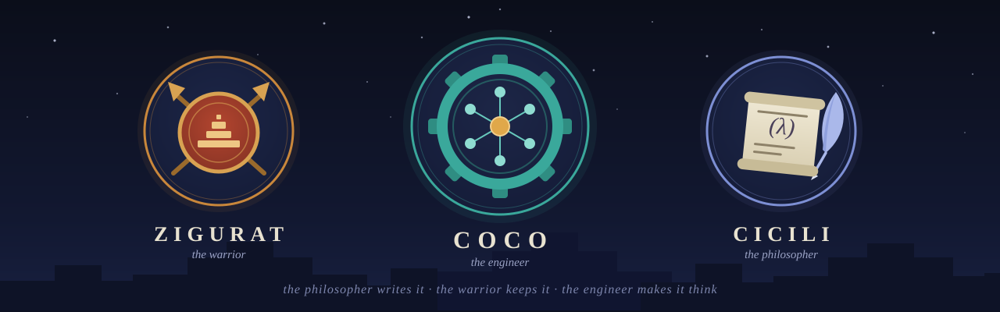

# cocolog


**Computation become durable knowledge.**

cocolog is a Prolog -- the ISO core, the everyday conveniences, and a checked
table for the few places it deliberately differs -- and a **state machine**,
whose running proofs are data that can be suspended into a database and
finished by another process, on another machine, a day later.

It is written in [Cicili](https://github.com/saman-pasha/cicili) and keeps its
knowledge base in [ZiguratIP](https://github.com/saman-pasha/ziguratip), and it
uses both without modifying either. One binary carries the interpreter, the
embedded MVCC store, the module loader and a Go-like scheduler; the knowledge
base is a runtime arrangement, not a build.

```console
$ cocolog --kb demo consult demo/family.pl
consulted 12 clause(s) into 'demo'

$ cocolog --kb demo start job "ancestor(tom,X)"
started 'job'

$ cocolog --kb demo --steps 12 step job          # one process
  1. ancestor(tom,bob)
  2. ancestor(tom,liz)
  3. ancestor(tom,ann)
  4. ancestor(tom,pat)
job: suspended at 12 inference(s), 4 answer(s) this turn

$ cocolog --kb demo --steps 12 step job          # a different process
  1. ancestor(tom,jim)
  2. ancestor(tom,zoe)
job: suspended at 24 inference(s), 2 answer(s) this turn
```

Between those two commands the machine was not in memory anywhere. It was
fifteen kilobytes of ASCII in a table, in four chunks: about a hundred bytes of
proof, and the names of every atom and functor it might meet.

**And its flow libraries are among the most powerful debugging tools a Prolog
has** -- a program charted without running it, and a run explained at no cost to
it. See [The flow libraries](#the-flow-libraries) below.

## What it is

| | |
|---|---|
| **A language** | A Prolog: the ISO core, DCGs, exceptions, `format`, eight libraries copied unmodified from SWI and read at start-up. The places it deliberately differs from the reference implementations are one table, every row checked by running the same goal on both: [COMPAT.md](COMPAT.md). |
| **A state machine** | A proof is a term. Freeze it, store it, read it back in another process, go on. The store is MVCC (ZiguratIP's MVCCS), transactional by the turn, and a clause is a row. |
| **A concurrency model** | Green threads as in Go -- `go`, `yield`, `await`, channels -- over ONE shared store, one worker a core, preempted at 10,000 steps. Real threads, which share nothing and copy terms. |
| **A bridge** | Twenty loadable modules over C and C++ libraries, each declared in a Cicili binding and called as Prolog: sockets, TLS, HTTP, WebSocket, OpenCV, raylib, libtorch, TensorFlow, curl, cryptography. No C pasted into Prolog strings. |

One binary. The knowledge base is chosen at run time: in memory (`--local`,
the default), in a ZiguratIP server over its binary protocol (`--kb`), over
TLS (`--tls`), over Zeytun/HTTP (`--http`, `--https`), or in the embedded store
linked into the binary itself (`--embed`).

## The one decision everything follows from

A term is an **index into a flat array of 64-bit cells**, not a pointer into a
graph, and the engine **never recurses in C**: the continuation is a term on the
heap and the choice points are an array of integers.

Written the natural way -- malloc'd term nodes and a recursive `solve()` that
uses the C stack as its continuation -- an interpreter is half the length. But
its state is then pointers and stack frames, and neither is data. cocolog exists
to stop mid-proof and go into a database, so:

| | |
|---|---|
| terms are indices | an array of indices is position independent: write it out, read it back at a different address, and every reference still means what it meant |
| the continuation is a term | `'$k'(Goal, Barrier, Rest)` on the heap, so a pending goal is a cell like any other |
| a cut barrier travels per goal | a suspended machine remembers the barrier of every pending goal, not only the current one |
| choice points are integer frames | `{kind, goals, trail_mark, heap_mark, call, pred, clause_ix, barrier}` and nothing else |

Freezing a machine is printing six arrays; thawing one is reading them back.
Every later choice -- compiled clauses, guards, environments, the heap
collector, the tracer, the green scheduler -- either preserves that property or
states in the code why it does not.

## Philosophy

* **The letter of the language, where it matters.** Not "familiar": the same
  text, the same errors, the same exit statuses. A float is written as the
  shortest text that reads back as the same double; `catch/3` stops catching
  once its goal exits; a cyclic term prints `@(S_1,[S_1=f(S_1)])`.
  `test/files/*.pl` runs the same files under a reference Prolog and compares
  every answer, and [COMPAT.md](COMPAT.md) is the one table of the places
  cocolog does not agree.
* **Measure, then claim.** No sentence in the benchmark claims a number that has
  not been printed by a run, and every lane's answers are checked against every
  other lane's before a time may print. The comparison pages keep cocolog's
  losses in: syntax errors, tabling, strings, ecosystem. See
  [bench/README.md](bench/README.md).
* **Documentation that runs.** Every tutorial is a program whose claims are
  `must/3` checks; the suite runs all 133 lessons. A lesson that stops being
  true fails and names both answers. The whole tree lints clean, held there by
  `cocolint` and `test/lint.pl`.
* **One mechanism, not two.** Errors are catchable and carry the raised ball; a
  module is a C API bound in Cicili; a library is clauses; a server page is a
  clause; a grammar is compiled in the engine. There is no second language
  hiding under the first.
* **Nothing rewritten that can be imported.** Eight of SWI's libraries, copied
  unmodified (BSD-2) into `lib/swipl/`; OpenSSL for crypto and TLS; libcurl for
  curl; ZiguratIP for the durable store; cicili for the language. The repository
  owns what it must -- the engine, the state format, the seam -- and borrows the
  rest.
* **The store is a seam, not a dependency.** The same feature is considered in
  every arrangement -- local, embedded, server, Zeytun -- and the differences
  are documented where they matter (a turn is a transaction; an httpd worker
  answers an isolated proof over a fresh store).

## Assets

**The engine** (`lib/`) -- cells and the trail; a reader and a writer that
agree with the standard text; compiled clauses (head and body programs keyed by the clause's cell);
guards that run a body's leading arithmetic as its clause is entered;
environments for bodies with constructs; a sliding mark-compact heap collector;
a tracer and recorder that record exactly what they print; limits in inferences
and steps; a backtrace carried by the throw itself.

**The state format** (`lib/state.cicili`) -- a suspended machine as text; four
sections plus the names; thawed, resumed and finished by any process.

**The knowledge base** (`lib/kb.cicili`, `lib/zigurat-kb.cicili`,
`lib/zeytun-kb.cicili`, `embed/`, `parsi/`) -- a clause store with five backend
hooks, an in-memory arrangement, an embedded MVCC store, a binary wire to a
ZiguratIP server and an HTTP arrangement; turns as transactions; vacuum and
compaction; pages and procedures compiled into the server (`parsi/`).

**The scheduler** (`lib/green.cicili`, `library/async.pl`) -- green threads in
a world of one worker a core, one store, shared name tables, a write barrier
that stops the world, channels, futures, deadlock detection. Tier 1: there with
no import.

**The libraries** -- tier 1 always present: `apply builtins dcg files library
lists zigurat`; **eight of SWI's own libraries, copied unmodified under their
BSD-2 headers into `lib/swipl/` and read at start-up**, so they need no import:
`assoc`, `pairs`, `ordsets`, `yall`, `aggregate`, `ugraphs`, `dcg_basics` and
`dcg_high_order`; and `async`. Tier 2 is loaded on demand from
`$COCOLOG_LIBRARY`:
`http`, `httpd`, `websocket`, `json`, `xml`, `html`, `ca`, `kbs`, `cowork`,
`main`, `astar`, `hex`, `template`, `clay_ray`, `tensor_expr`, `llm`, plus the
two families below -- `library/flow/` and `library/reasoning/`.

**The modules** (twenty; `sh modules/NAME/build.sh`, not part of `make`):

| needs nothing | `tcp` `thread` `process` `text` `os` `signal` `clay` `stream` |
|---|---|
| a built ZiguratIP | `sha` `aes` `der` `x509` `tls` `bigint` |
| an external library | `curl`, `torch`, `tensorflow`, `ray`, `numpy`, `opencv` |

**The tools** -- `cocolint` (the dialect linter; the whole tree is clean);
`library(flow/chart)` and `library(flow/debug)` (below); `tools/compile/`
(which clauses nothing changes while a program runs); `tools/cc/` (the clang
wrappers every build uses); `bench/langs.sh` and `bench/concurrency.sh` (the
benchmarks against CPython, Go, Rust, asyncio and the reference Prolog);
`tutorials/` (133 lessons that run); `test/` (the suite).

## Solutions to real problems

**A computation that outlives its process.** Start a query against the
knowledge base, take a turn of it, halt. The next process -- tomorrow, on
another host -- steps it again, or runs it to the end. No checkpointing layer,
no serialized C stack: the proof is clauses in a table, and the turn's writes
committed as one transaction. `library(kbs)` is the same idea with a handful of
named jobs held by the store.

**Knowledge that must be durable and fast.** A clause is a row; a keyed lookup
is an index probe. On the language benchmark's store lane, a thousand keyed
lookups over two hundred facts cost `--embed` 0.36 ms against `python +
sqlite3`'s 11.9 ms -- **33x faster** (36x through the server), and a
hundred-thousand-addend counting loop, where every addend is a row, is 2.1x
faster. Level on naive reverse; 1.3-2.4x behind where the work is computation
over data read once. The table and the method are in
[bench/README.md](bench/README.md), and Run N is the run above.

**Text and language at corpus scale.** `library(reasoning)` reads controlled
English into an IR and writes it into a lesson's language; its translator
crosses Italian, Spanish and English newspaper prose, the tagger is a GRU over
`tensor_expr`, and the corpus, lexicon and model are all in the repository. New
articles are taken through a fixed loop -- shapes, `extra/` lines, a fresh
store, controls against every earlier article, a data column against the old
store -- and every inference count is recorded. Lessons 43-46.

**Concurrency with one truth.** Green threads share one store: an `assertz` in
one task is seen by the next, because it is their store, and writes take the
world's barrier to make that true. Real threads get a machine, a store and a
connection of their own and copy terms through channels. `library(httpd)`
serves under three modes -- `concurrency(none)` on the calling thread,
`concurrency(thread(N))` with each request an isolated proof (fresh machine and
store, one commit), and `concurrency(green(N))` with green tasks over the one
shared store. `library(cowork)` runs cooperating cores on one problem.

**Vision, graphics and learning.** `library(opencv)` (images, features,
detection, dnn), `library(ray)` (windows, sprites, pixels), `library(torch)` and
`library(tensorflow)` (device-resident tensors, eager gradients, saved models)
and `library(tensor_expr)` (a small expression language the tensor lessons are
written in) -- lessons 22 (torch), 29 (ray), 39 (tensor expressions) and 41
(OpenCV) in `library/`, and the forty-two lessons in `tensor/`.

**Services.** `library(httpd)` serves clauses as pages over plain sockets, unix
socket files and TLS, with keep-alive, static roots, a page inference limit and
a worker pool; `library(websocket)` adds the upgrade; `library(json)`,
`library(xml)` and `library(html)` go both ways; `library(curl)` fetches;
`library(tls)` and the `sha`/`aes`/`der`/`x509`/`ca` modules do cryptography
with keys as files, never terms.

## The flow libraries

**`library(flow/chart)` and `library(flow/debug)` are the most precious thing in
this repository for anyone who writes Prolog.**

* **What a program CAN do, without running it** (`flow/chart`): each predicate
  drawn from the query down to the C it reaches -- the mode of every argument,
  how each can end (det, semidet, nondet), where every failure goes, the
  threads, channels and processes it starts -- and what is wrong, printed as a
  compiler prints it: a call nothing answers (with the name it probably meant),
  an argument free where the engine refuses one, left recursion, a clause never
  tried, a determinism promise not kept, a thread never joined, a lock kept on a
  way out, a predicate whose clauses are not together.
* **What a query DID, at no cost to the run** (`flow/debug`): the program runs
  untraced at full speed in a child process to the window of inferences asked
  for, and only that window is recorded and drawn over the chart: the path
  heavy, failures red, an exception purple, every value that crossed into a
  variable the source names. A journal answers every call that reaches the world
  -- the clock, a file, a stream, a thread, the knowledge base -- so the replay
  is the run it explains and does nothing twice.

## The Emacs mode

[emacs/](emacs/README.md) holds **cocolog-mode**, a Prolog major mode with two
ideas of its own: a variable can be a **colour** instead of a name -- same
colour, same variable, which is how Prolog scopes them anyway -- and a test
case lives in a comment beside its rule, where `C-c C-t` runs it and draws the
whole execution graph underneath, every clause tried, as comments that survive
git and any other editor.

The mode carries its own Prolog engine in Emacs Lisp, so all of that works with
nothing installed -- and that engine is a deliberate shadow of this interpreter,
held to it twice over: offline, `make coco` in `emacs/` asks both the same 234
queries and compares; live, every graph drawn on a machine with a cocolog binary
is certified against it on the spot, with the four-port trace of the rule
refreshing alongside. Pickers insert goals, grammar pieces and torch rules
(`C-c C-i`, `C-c C-g`), and `C-c C-e` traces a goal under the real interpreter
in any of the four knowledge-base arrangements.

## Best libraries and tools

| what you want | reach for |
|---|---|
| understand a program, or one run of it | `library(flow/chart)`, `library(flow/debug)` -- lessons 50 and 51 |
| write Prolog in Emacs | `cocolog-mode` in [emacs/](emacs/): colour variables, tests in comments with execution graphs, an embedded shadow engine |
| catch the traps of this dialect before they bite | `sh tools/cocolint/lint.sh FILE.pl`; the card, the index, `make lint` |
| Go-style concurrency inside one process | `library(async)`, tier 1: `async_run`, `go`, `yield`, `await`, channels |
| an HTTP server whose pages are clauses | `library(httpd)` -- `concurrency(none/thread/green)`; lesson 16 |
| a durable store, embedded or served | `--embed`; `--kb` to a ZiguratIP server; `library(kbs)` for named jobs |
| frames, images, vision, ML | `library(opencv)`, `library(ray)`, `library(torch)`, `library(tensorflow)`, `library(tensor_expr)` |
| documents in and out | `library(json)`, `library(xml)`, `library(html)`; the round trip is the test |
| cryptography and TLS | `library(ca)`, `library(tls)`, and the `sha`/`aes`/`der`/`x509` modules |
| sockets, processes, streams, text, regex | `library(tcp)`, `library(process)`, `library(stream)`, `library(text)`, `library(regex)`, `library(os)`, `library(signal)` |
| graphs, paths, hex grids | `library(astar)`, `library(hex)` |
| a whole proof captured and resumed | `cocolog start`, `step`, `run`; `lib/state.cicili` |
| knowing how fast it is, honestly | `sh bench/langs.sh`, `sh bench/concurrency.sh`, [bench/README.md](bench/README.md) |

## Getting started

```sh
export CICILI=/path/to/cicili          # a Cicili checkout
export ZIGURATIP=/path/to/ZiguratIP    # a BUILT ZiguratIP checkout
make                                   # the one cocolog binary, embedded store linked in
make modules                           # the loadable modules this box can build
./cocolog query "append(X, [c], [a,b,c])"
./cocolog -s tutorials/basics/01-facts-and-rules.pl
```

`sudo sh install/install-linux.sh` installs from scratch on Linux; a Docker
image and a macOS section are in the long tour. `make EMBED=0` builds the same
binary without ZiguratIP.

The suite is one cocolog script -- `make test` -- and it ends `red: 0` over
**75 lines: seven Cicili test binaries (term, syntax, solve, module, state,
zigurat, shared) and sixty-eight Prolog cases**. Cases that need a server,
a reference Prolog 9.0.4, raylib, libtensorflow or a CUDA toolkit say `SKIP`
by name rather than failing, so read the lines and count the SKIPs, not only
the verdict.

## Where to read next

* [MORE.md](MORE.md) -- the long README this one replaced: every library, every
  arrangement, the store's design, twelve interpreters in four states, the
  tracer, the Emacs mode, the measurements in full.
* [STATUS.md](STATUS.md) -- what is proved, what it cost, what is known missing.
* [COMPAT.md](COMPAT.md) -- the one table of every difference from the
  reference Prologs and ISO, each row checked by running the same goal on
  both.
* [MODULES.md](MODULES.md) -- how to write a module in Cicili.
* [bench/README.md](bench/README.md) -- the runs, the method, and the losses.
* [library/async/README.md](library/async/README.md) -- the green world: the
  model, the barrier, the benchmarks and the limits.
* [emacs/README.md](emacs/README.md) -- cocolog-mode: the colour-variable
  reading, the in-comment tests, the shadow engine and its checks.

cocolog 2.12.1. README.md says what it is, STATUS.md what is proven, MODULES.md
how a module is written.
